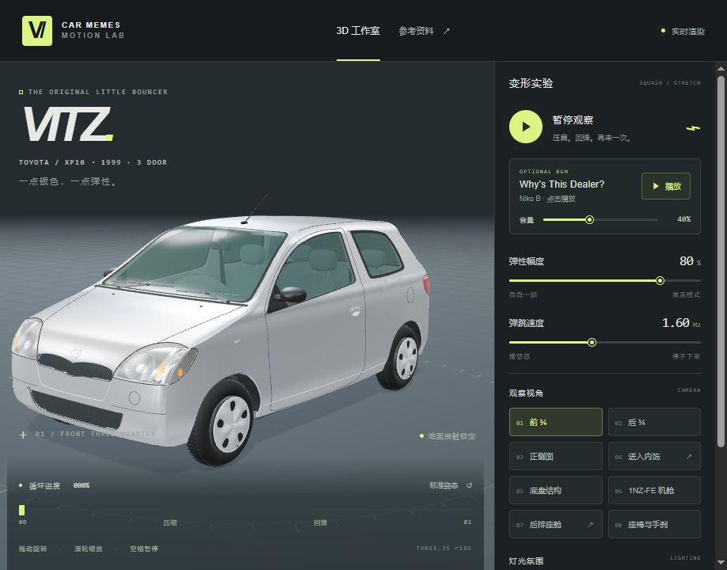

# VITZ — Motion Lab

**v1.0.0 · 银色初代 Toyota Vitz / XP10 三门车的 Three.js 三维互动工作室。**

根据多视图重建外观，参照初代实车照片制作右舵内饰。车辆由程序化三维网格构建，可以从车身、座舱、机舱和底盘多个角度查看，并复刻轮胎贴地的压缩与回弹。



## 使用

- 拖动旋转相机，滚轮缩放；空格播放/暂停。
- 调节弹性幅度和弹跳速度；拖动底部进度条可停在任意姿态。
- 侧栏 BGM 卡片可独立播放/暂停《Why’s This Dealer?》，音量可调至 0%；歌曲循环播放。默认不自动播放，暂停小车或切换视角不会操作音乐。
- 「标准姿态」暂停并恢复原始车体比例。
- 八个相机预设：前 ¾、后 ¾、正侧面、前排内饰、底盘、1NZ-FE 机舱、后排座舱、座椅与手刹。
- 摄影棚/午夜蓝灯光、自动环绕和真实几何网格显示。
- 「参考资料」可查看用户的多视图、内饰照片和来源。

进入内饰时先暂停、恢复标准比例；此后仍可播放或拖动进度，相机随车厢一起变形。底盘与机舱视角会暂时隐藏车壳，切回普通视角即可恢复。外观相机会根据窗口比例调整取景。系统偏好减少动态效果时默认暂停；页面隐藏时动画时钟暂停。

## 启动与构建

使用 **Node.js 24** 和随附的 npm，在项目根目录打开终端：

```sh
npm ci --include=optional
npm run dev
```

开发地址 <http://127.0.0.1:5174/>。

```sh
npm test
npm run build
npm run preview
```

生产预览地址 <http://127.0.0.1:4174/>。`dist/` 可独立静态部署，也支持相对子目录；请通过 HTTP 服务访问。开发中修改跨模块接口时若热更新保留旧模块，完整刷新；交付检查使用完整构建的生产预览。

依赖固定为 Three.js 0.186.1、类型定义 0.186.0、Vite 8.3.5、TypeScript 7.0.2，并保存在 `package-lock.json`。保留安装命令中的 `--include=optional`，以安装当前平台需要的原生工具包。

已在 Windows / Node.js 24.21.0 上验证。npm 和 Vite 缓存分别保存在 `.work/npm-cache` 和 `.work/vite`，不纳入 Git。

## 模型与动画

所有车体、玻璃、车轮和内饰均是真实三维网格，可从任意方向查看。车身包含轮拱、三门结构、车窗支柱、灯组、蜂窝格栅、轮盖、后视镜、门把手、尾门、雨刷和天线。车厢包含带织物纹理的双前座与后排、门板、内衬、安全带、中置数字仪表、圆出风口、三辐方向盘、自动挡排挡、踏板与手刹。底盘与 1NZ-FE 机舱包含主要结构、部件及连接管线。

外观精修版按近景照片和多视图重新绘制侧面轮廓、平缓拱顶、主侧窗与短后侧窗。侧壳有真实开窗，车顶、前后挡风和车身共用边界曲线；前后灯嵌入车壳并包到翼子板，包含反光碗、灯罩、转向灯、红色灯区和透明分区。曲面法线根据映射的导数计算，避免细长三角形在车顶边缘产生碎高光。首版进一步打磨了前挡下角钣金和前挡到车顶的过渡。

这是一版可继续编辑的程序化近似模型，非厂家 CAD；曲面、灯具和饰件精度仍可细化。尺寸以 1999 年丰田发布资料的 3.61 × 1.66 × 1.50 m、轴距 2.37 m 为基准，天线另计。参考图中的反向侧视没有照搬为矛盾结构。

压缩/回弹以世界地面 `y=0` 为原点，整车沿 y 缩放并在 x/z 补偿体积，不施加向上平移。轮胎随车体一起产生夸张的形变；这不是悬架物理模拟。运动由确定性的循环相位驱动，便于以后接入视频逐帧渲染。

## 文件

- `src/car.ts`：组装车辆；`exterior.ts` / `interior.ts`：外观组装与内饰。
- `src/profile.ts` / `body.ts`：共享轮廓、连续车壳、车顶与开窗。
- `src/lamps.ts` / `details.ts`：嵌入灯组、轮组、接缝和饰件。
- `src/mirrors.ts`：后视镜外壳、边框和内嵌镜片。
- `src/dashboard.ts` / `steering.ts` / `rear-cabin.ts`：仪表台、方向盘和后排。
- `src/front-seatbelts.ts` / `cabin-trim.ts` / `footwell.ts`：安全带、内衬和踏板。
- `src/chassis.ts` / `engine.ts`：底盘与机舱。
- `src/geometry.ts` / `shape-mesh.ts`：曲面工具、共边细分与曲面法线。
- `src/materials.ts` / `textures.ts`：材质及程序生成的仪表、织物和车牌纹理。
- `src/motion.ts`：纯函数弹跳曲线和贴地变形。
- `src/scene.ts`：灯光、地面、相机、取景适配、渲染和资源释放。
- `src/main.ts` / `style.css` / `index.html`：交互、时钟和响应式界面。
- `src/bgm.ts` / `public/audio/whys-this-dealer.mp3`：独立的背景音乐控制与本地原曲；只在用户点击播放时加载音频。
- `src/model.ts` / `public/models/`：保留的 glTF/GLB 导入入口，可供后续版本使用。
- `references/SOURCES.md`：照片与车辆资料来源；`public/references/`：本地参考板。
- `checks/`：实际页面截图和验证记录。

以本目录为 Git 仓库根目录即可独立运行，不依赖同级 SVG、GIF 或 Remotion 项目。提交源码、测试、配置、锁文件、文档和 `public/` 中实际使用的资源。`.gitignore` 排除了依赖、构建输出、缓存、临时检查记录、日志和本地环境文件；README 的预览图单独保存在 `docs/images/`。

## 验证

`npm test` 当前包含 **60 项检查**，覆盖循环接缝、压缩/回弹、零幅度、体积补偿、轮胎贴地，以及曲面衔接、玻璃、灯组、门缝、后视镜、内饰、安全带、底盘和机舱。`npm run build` 同时执行 TypeScript 检查和生产构建。首版检查记录见 [更新记录](CHANGELOG.md) 和 [前挡及钣金修正记录](docs/front-metal-flow.md)。

`docs/` 保留了各阶段设计与修正记录。其中引用的 `checks/` 是本地验证输出，不纳入 Git。这些数值检查用于发现几何和渲染错误，外观相似度通过实际视图与照片对照判断。

`scripts/verify-refinement.mjs` 是早期外观精修阶段的额外检查脚本；当前首版的回归入口为 `npm test`。

内饰参考来自 [MOTA 初代 Vitz 图库](https://autoc-one.jp/catalog/toyota/vitz/fmc632-mc2032/49389/)，照片已下载并目视核对。车型尺寸和内饰布局另以 [丰田 1999 年发布资料](https://global.toyota/en/newsroom/toyota/24168318.html) 交叉核对。照片用作本地参考，不是车体贴图。
